# Tactical Calories

[Português](README.md) · **English**

**A food and hydration tracker built to keep working when the connection does not.**

Tactical Calories is a personal full-stack project: a responsive, installable web app for tracking meals, calories, macronutrients, water intake, and daily goals. It combines a React interface with a NestJS API and PostgreSQL, with a local replica and a durable queue for supported offline actions.

This repository presents the product and its engineering decisions. The application source code is maintained privately.

**React · Next.js · TypeScript · NestJS · PostgreSQL · Prisma · Zod · Playwright**

[LinkedIn](https://www.linkedin.com/in/gustavo-santana-83ba611a6/) · [GitHub](https://github.com/gustavo867)

## Quick demo

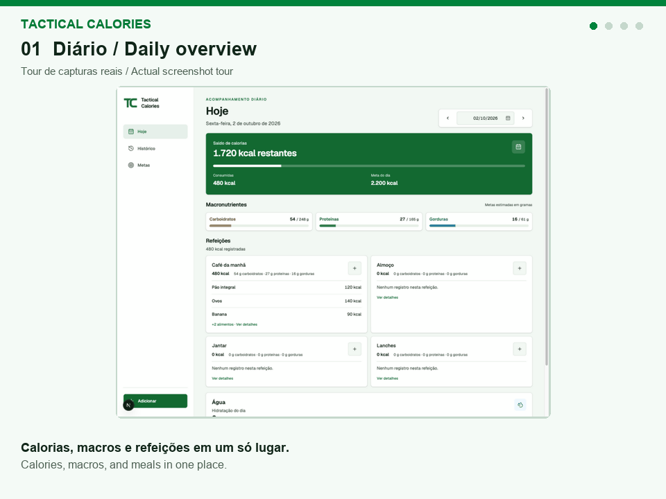

A 24-second GIF assembled from actual development screenshots. This is a screen presentation, without simulated clicks or a continuous recorded session. [Sources and context](assets/demo/README.en.md).

## v0.7.0 highlights

- **616 foods in the local catalog:** 597 preserved TACO entries and 19 curated USDA SR Legacy references, including prepared mustard and tilapia. Food details identify the source; foods are searchable offline after synchronization.
- **Copy yesterday’s meal from the destination:** the card opens a review of the same meal on the day before the selected date, with explicit source and destination. Nutritional history is preserved; canceling records no consumption and restores focus to the trigger.
- **Edit your own public foods:** “My foods” lists private and public items created by the account. Authors can edit both while retaining IDs and past entries; deleting public foods remains blocked.

Updated against the product’s `main` on November 8, 2026, following the v0.7.0 promotion. [Validation references and limits](docs/engineering.en.md#v070-reference).

## Architecture in 30 seconds

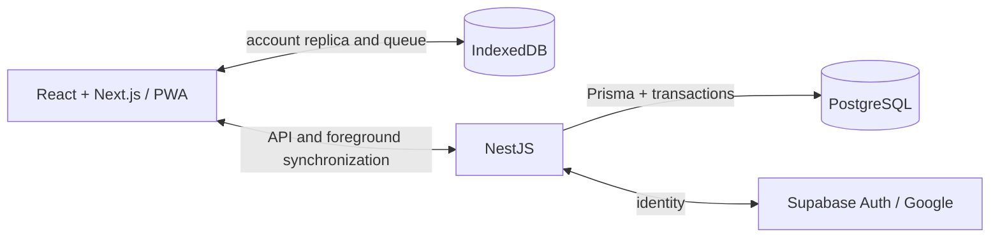

The Service Worker caches static assets; IndexedDB persists account data and pending operations. NestJS verifies the session before applying operations in PostgreSQL. Initial preparation needs a connection, and synchronization runs while the app is open. [Full architecture](docs/architecture.en.md).

## Three key technical decisions

1. **Retry without duplication.** Stable IDs and receipts written in the same transaction as consumption allow a request with a lost response to be retried without recording the meal twice.
2. **Resolve conflicts explicitly.** Goal revisions and nutritional hashes detect remote changes; the interface preserves pending work for review, and historical entries retain the values used when recorded.
3. **Isolate each account's queue.** IndexedDB partitions, session revalidation, and expected-account checks prevent one account's pending work from being submitted through another account's session.

[Engineering case studies and tests](docs/engineering.en.md).

[Product tour](#product-tour) · [Architecture](docs/architecture.en.md) · [Engineering challenges](docs/engineering.en.md) · [AI-assisted development](#ai-assisted-development)

## Why I built it

Recording a meal should remain possible through a connection failure. The engineering challenge is making local changes durable, reconciling them with an account later, and making the difference between “saved on this device” and “synced to your account” clear.

The project explores that problem end to end: browser persistence, API contracts, database transactions, conflict recovery, and automated browser tests.

## What the app does

- Tracks food intake, calories, macronutrients, hydration, meal notes, and goals that take effect from a chosen date.
- Searches a curated TACO and USDA food catalog and supports personal foods with private or explicitly shared visibility and author editing.
- Handles quantities in grams, servings, and custom household measures, with a review step for multi-food selections.
- Copies meals and saves reusable favorite combinations while preserving the original nutritional values.
- Shows historical intake and the goals applicable to each day.
- Supports Google sign-in and installation as a Progressive Web App (PWA).
- Saves supported individual diary actions offline and synchronizes them after reconnection and account verification.

## Product tour

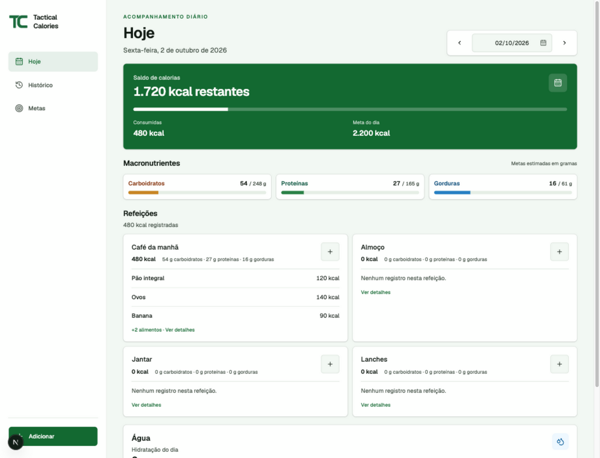

The interface is in Brazilian Portuguese. These are actual development and validation captures, with illustrative entries; they represent different iterations of the product. See [screenshot notes](assets/screenshots/README.en.md) for provenance and context.

<table>
  <tr>
    <th>Food search</th>
    <th>Reusable meals</th>
    <th>Offline entry</th>
  </tr>
  <tr>
    <td valign="top">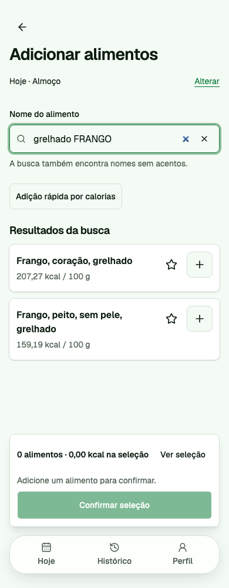</td>
    <td valign="top">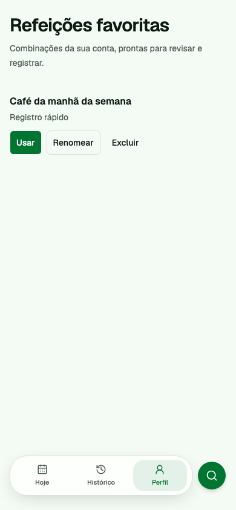</td>
    <td valign="top">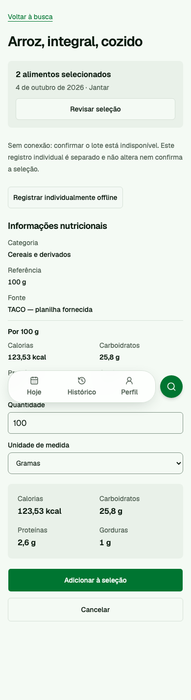</td>
  </tr>
  <tr>
    <td>Search the catalog and review a selection before recording it.</td>
    <td>Save meal combinations and review them before reuse.</td>
    <td>Keep individual offline entry available without silently submitting a batch.</td>
  </tr>
</table>

Desktop meal actions and hydration

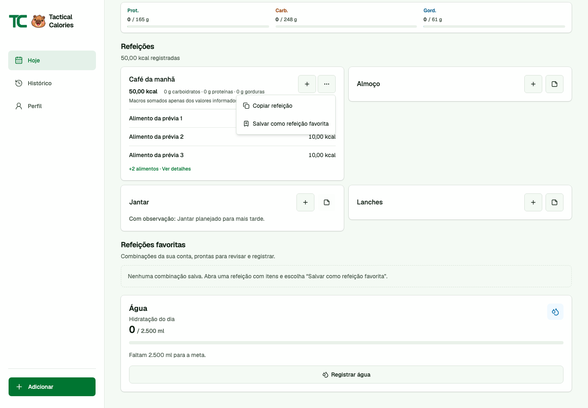

New v0.7.0 flows: catalog, yesterday’s meal copy, and My foods

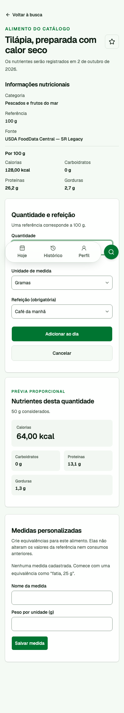

The complementary catalog identifies the source and scales the preview to the chosen quantity. [Desktop version](assets/screenshots/catalog-tilapia-desktop.png) · [Desktop mustard](assets/screenshots/catalog-mustard-desktop.png) · [Mobile mustard](assets/screenshots/catalog-mustard-mobile.png).

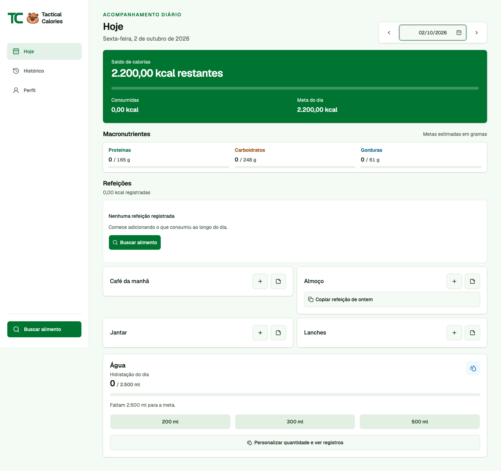

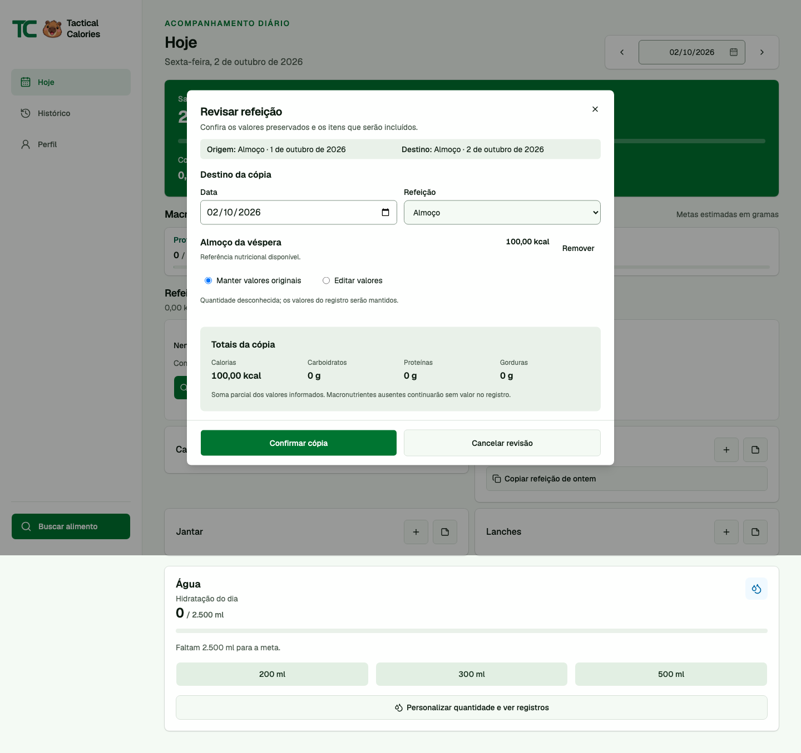

“Yesterday” is relative to the selected diary date; review comes before recording.

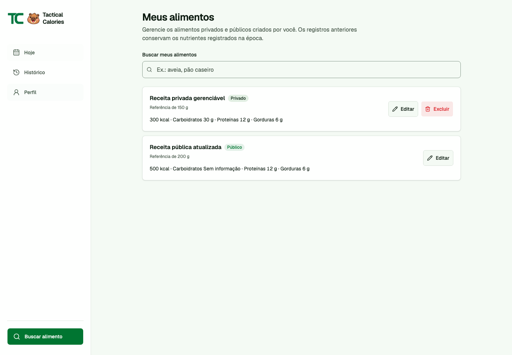

## Architecture and stack

The frontend is a **static Next.js export**. NestJS owns authentication and the API on the same origin; PostgreSQL is accessed through Prisma. IndexedDB stores the local account replica and pending operations. A Service Worker caches the static application shell.

| Layer             | Technologies and responsibilities                                                      |
| ----------------- | -------------------------------------------------------------------------------------- |
| Interface         | React, Next.js, TypeScript; responsive diary and review flows                          |
| Local persistence | IndexedDB; confirmed snapshots, pending operations, and account isolation              |
| PWA               | Manifest and Service Worker; installable shell and offline startup after preparation   |
| API               | NestJS; session verification, authorization, validation, and synchronization endpoints |
| Contracts         | Shared Zod schemas and TypeScript types for frontend and backend                       |
| Data              | Prisma, PostgreSQL, versioned SQL migrations, transactions, and row-level security     |
| Identity          | Google OAuth through Supabase Auth, mediated by the backend                            |
| Quality           | Unit tests, HTTP integration tests, SQL tests, and Playwright                          |
| Delivery          | Bun workspace, GitHub Actions; deployment configuration for Vercel and Supabase        |

See the [architecture diagram and synchronization flow](docs/architecture.en.md).

## Testing and delivery

The private application includes tests for response loss and replay, account switching, expired sessions, goal and food-reference conflicts, IndexedDB write failures, concurrent tabs, and stale bootstrap responses.

HTTP integration tests run against the NestJS API and an isolated PostgreSQL database with a local Auth fixture. Playwright exercises the exported frontend and API, with desktop, mobile, and WebKit mobile configurations. Mobile browser emulation does not establish physical iPhone coverage.

GitHub Actions conservatively selects package suites for PRs targeting `staging`; shared or uncertain changes broaden selection, and documentation-only changes can skip application jobs. PRs targeting `main` and manual runs execute full validation, including database/HTTP integration and the Playwright matrix. Bun download and Next.js build caches are separate from the current build artifact; passing test results are not reused. [Decisions and promotion evidence](docs/engineering.en.md#v070-reference), without claiming measured savings.

## AI-assisted development

For this project, I used only Codex as a development assistant for planning, implementation, debugging, and code review. The project also contains an agent orchestration workflow with scoped task briefs, file ownership, model selection, and verification requirements.

My responsibility is to define the product behavior, evaluate proposed changes, and validate the result against the application's contracts and tests. AI-generated changes go through the same review and verification requirements as other changes.

AI assistance is part of the development workflow. The application's documented features do not include model-based nutrition analysis or AI-generated dietary recommendations.

## Offline scope and trade-offs

- Initial sign-in and account preparation require a connection. After preparation, the local diary and synchronized food catalog can be used offline.
- Supported individual actions use the persistent queue. Batch confirmation, household-measure registration, meal reuse, favorite-meal management, editing owned foods, and deletion/undo require a connection and prior synchronization of pending individual actions.
- Synchronization runs in the foreground after session verification. Closed-window background synchronization is not guaranteed.
- Pending data depends on browser storage; clearing or eviction can remove it.

## About this repository

This is a documentation and screenshot showcase, not a runnable application distribution. It contains no application source, credentials, private account records, or original Git history. Deployment configuration in the private project is not presented here as a verified public demo.

Created by [Gustavo Santana](https://github.com/gustavo867).
