# Tactical Calories

**Português** · [English](README.en.md)

**Um diário de alimentação e hidratação que continua funcionando quando a conexão falha.**

Tactical Calories é um projeto pessoal full stack: uma aplicação web responsiva e instalável para acompanhar refeições, calorias, macronutrientes, consumo de água e metas diárias. Combina uma interface React com API NestJS e PostgreSQL, além de réplica local e fila persistente para as ações disponíveis offline.

Este repositório apresenta o produto e suas decisões de engenharia. O código-fonte da aplicação é mantido privado.

**React · Next.js · TypeScript · NestJS · PostgreSQL · Prisma · Zod · Playwright**

[LinkedIn](https://www.linkedin.com/in/gustavo-santana-83ba611a6/) · [GitHub](https://github.com/gustavo867)

## Demonstração rápida

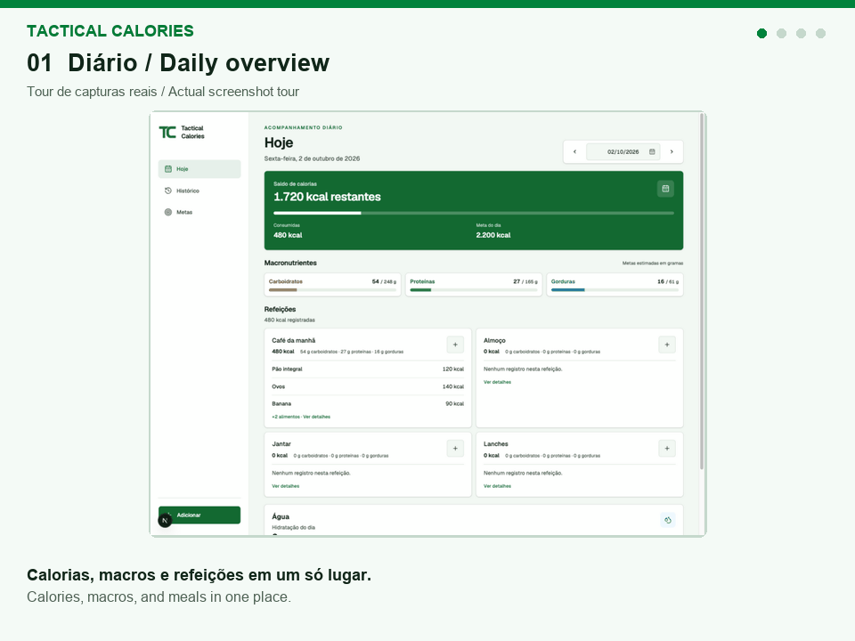

GIF de 24 segundos montado com capturas reais de desenvolvimento. É uma apresentação de telas, sem simular cliques ou uma sessão contínua. [Origem e contexto](assets/demo/README.md).

## Destaques da v0.7.0

- **616 alimentos no catálogo local:** 597 TACO preservados e 19 referências USDA SR Legacy curadas, incluindo mostarda preparada e tilápia. A fonte aparece no detalhe; os alimentos ficam disponíveis para busca offline após sincronização.
- **Copiar a refeição de ontem pelo destino:** o card abre a revisão da mesma refeição do dia anterior à data selecionada, com origem e destino explícitos. O histórico nutricional é preservado; cancelar não registra consumo e devolve o foco ao acionador.
- **Editar alimentos públicos próprios:** “Meus alimentos” reúne itens privados e públicos criados pela conta. O autor pode editar ambos, preservando IDs e registros anteriores; excluir alimentos públicos continua bloqueado.

Atualizado com base na `main` do produto em 08/11/2026, após a promoção v0.7.0. [Referências e limites da validação](docs/engineering.md#referência-da-v070).

## Arquitetura em 30 segundos

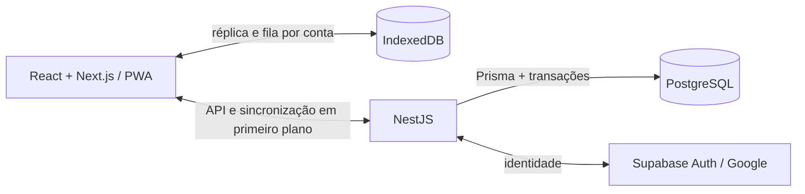

O Service Worker guarda os arquivos estáticos; o IndexedDB persiste dados e pendências por conta. O NestJS verifica a sessão antes de aplicar as operações no PostgreSQL. A primeira preparação exige conexão, e a sincronização ocorre com o aplicativo aberto. [Arquitetura completa](docs/architecture.md).

## Três decisões técnicas principais

1. **Repetir sem duplicar.** IDs estáveis e comprovantes gravados na mesma transação do consumo permitem reenviar uma operação cuja resposta se perdeu sem registrar a refeição duas vezes.
2. **Resolver conflitos explicitamente.** Revisões de metas e hashes nutricionais detectam alterações remotas; a interface preserva a pendência para revisão, e os registros históricos mantêm os valores usados no consumo.
3. **Isolar a fila de cada conta.** Partições no IndexedDB, revalidação da sessão e verificação da conta esperada impedem que pendências de uma conta sejam enviadas pela sessão de outra.

[Estudos de engenharia e testes](docs/engineering.md).

[Conheça o produto](#conheça-o-produto) · [Arquitetura](docs/architecture.md) · [Desafios de engenharia](docs/engineering.md) · [Desenvolvimento com IA](#desenvolvimento-com-ia)

## Motivação

Registrar uma refeição deve continuar sendo possível durante uma falha de conexão. O desafio de engenharia é persistir as alterações locais, conciliá-las com a conta posteriormente e deixar clara a diferença entre “salvo neste dispositivo” e “sincronizado com a conta”.

O projeto explora esse problema de ponta a ponta: persistência no navegador, contratos de API, transações no banco, recuperação de conflitos e testes automatizados de navegador.

## Funcionalidades

- Registro de alimentos, calorias, macronutrientes, hidratação, observações por refeição e metas com vigência por data.
- Busca no catálogo curado TACO e USDA e cadastro de alimentos pessoais, privados ou compartilhados explicitamente, com edição pelo autor.
- Quantidades em gramas, porções e medidas caseiras personalizadas, com revisão de seleções de vários alimentos.
- Cópia de refeições e combinações favoritas reutilizáveis, preservando os valores nutricionais originais.
- Histórico de consumo e das metas vigentes em cada dia.
- Login Google e instalação como Progressive Web App (PWA).
- Persistência offline das ações individuais de diário suportadas, com sincronização após reconexão e verificação da conta.

## Conheça o produto

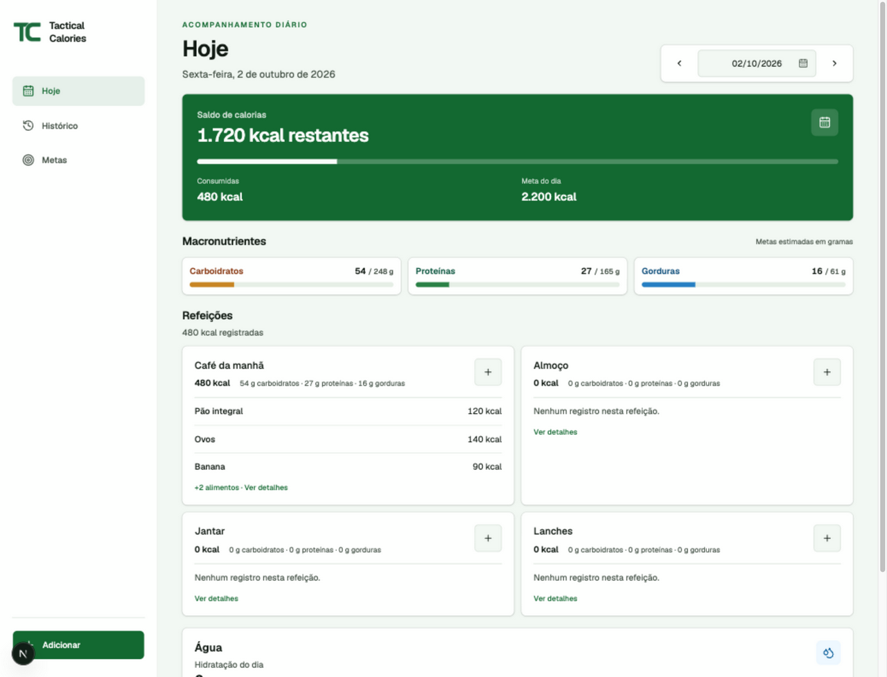

A interface está em português brasileiro. As imagens são capturas reais de desenvolvimento e validação, com registros ilustrativos, e representam diferentes versões do produto. Consulte as [notas das capturas](assets/screenshots/README.md) para origem e contexto.

<table>
  <tr>
    <th>Busca de alimentos</th>
    <th>Refeições reutilizáveis</th>
    <th>Registro offline</th>
  </tr>
  <tr>
    <td valign="top">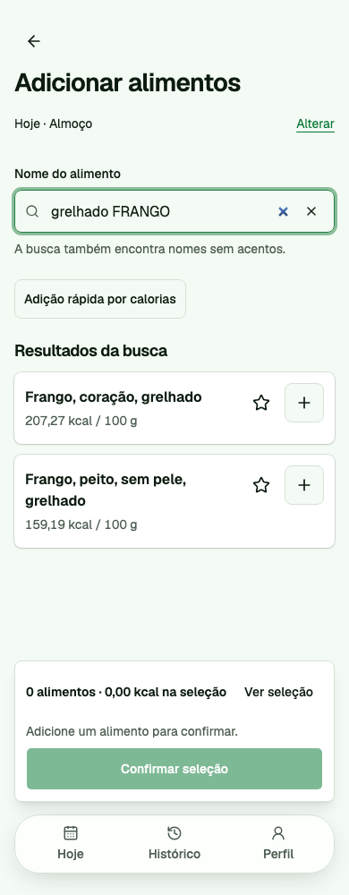</td>
    <td valign="top">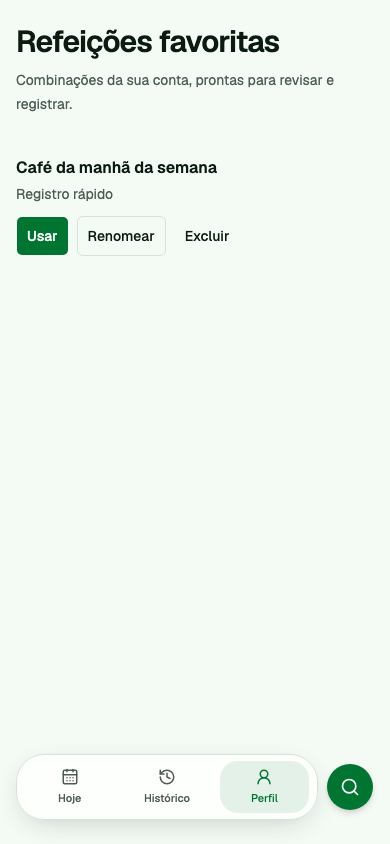</td>
    <td valign="top">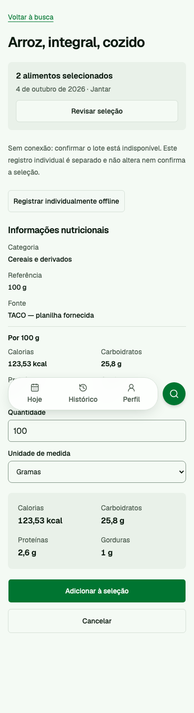</td>
  </tr>
  <tr>
    <td>Busca no catálogo e revisão da seleção antes de registrar.</td>
    <td>Combinações salvas para revisar e reutilizar.</td>
    <td>Registro individual offline sem confirmar o lote automaticamente.</td>
  </tr>
</table>

Ações de refeição e hidratação no desktop

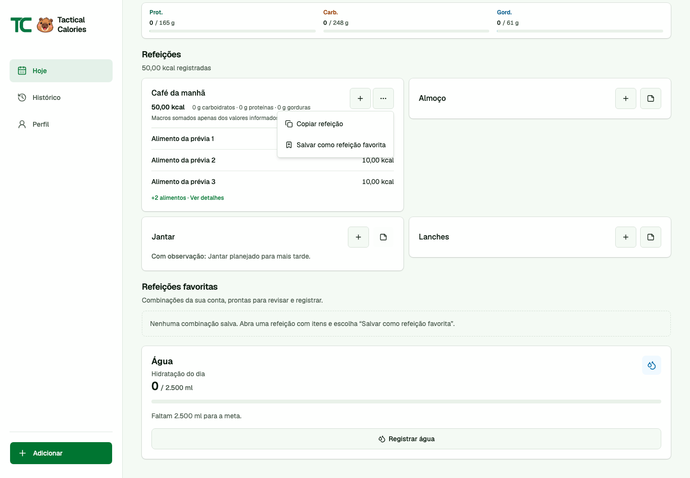

Novos fluxos da v0.7.0: catálogo, cópia de ontem e Meus alimentos

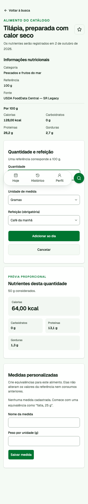

O catálogo complementar identifica a fonte e mantém a prévia proporcional à quantidade. [Versão desktop](assets/screenshots/catalog-tilapia-desktop.png) · [Mostarda no desktop](assets/screenshots/catalog-mustard-desktop.png) · [Mostarda no celular](assets/screenshots/catalog-mustard-mobile.png).

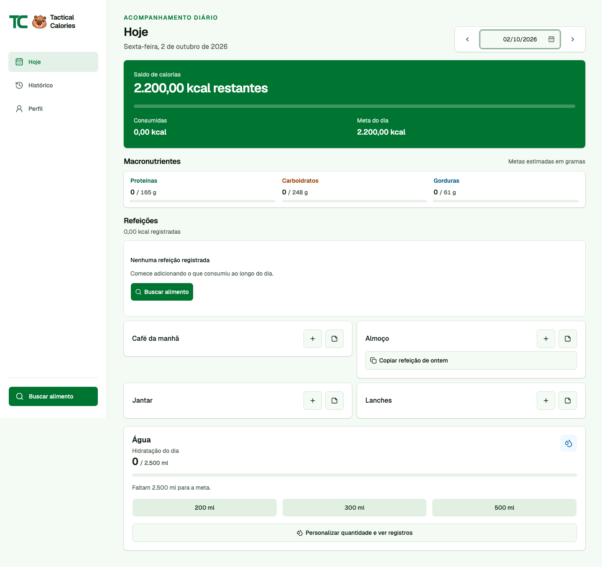

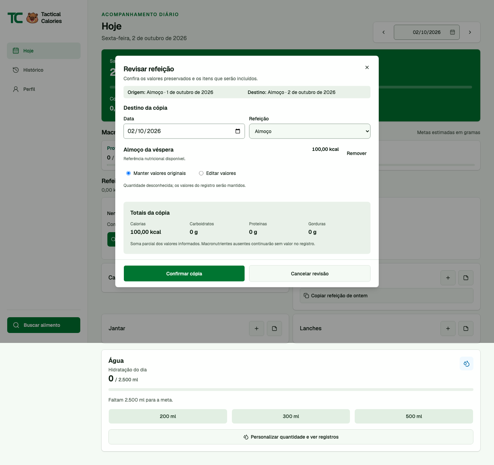

“Ontem” é relativo à data selecionada no diário; a revisão antecede o registro.

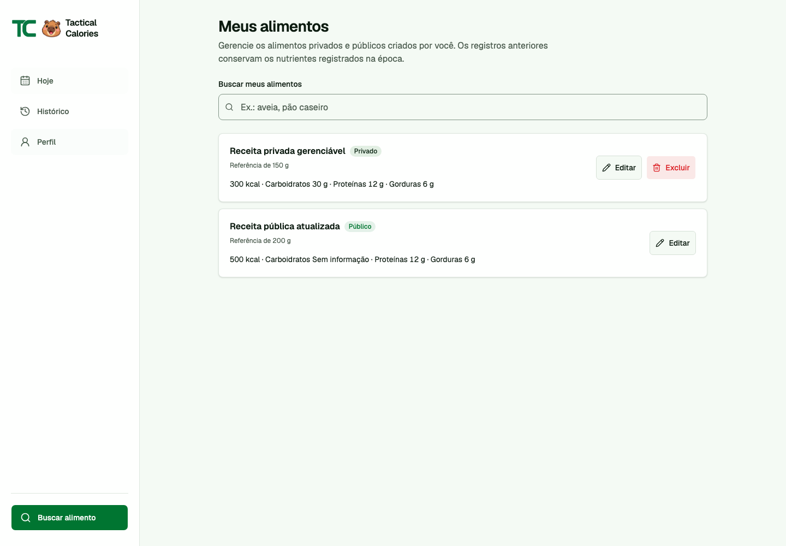

## Arquitetura e tecnologias

O frontend é uma **exportação estática do Next.js**. O NestJS controla a autenticação e a API na mesma origem; o acesso ao PostgreSQL usa Prisma. O IndexedDB armazena a réplica local da conta e as operações pendentes. Um Service Worker mantém o cache dos arquivos estáticos da aplicação.

| Camada             | Tecnologias e responsabilidades                                                        |
| ------------------ | -------------------------------------------------------------------------------------- |
| Interface          | React, Next.js e TypeScript; diário responsivo e fluxos de revisão                     |
| Persistência local | IndexedDB; estado confirmado, operações pendentes e isolamento por conta               |
| PWA                | Manifest e Service Worker; aplicação instalável e abertura offline após preparação     |
| API                | NestJS; verificação de sessão, autorização, validação e sincronização                  |
| Contratos          | Schemas Zod e tipos TypeScript compartilhados entre frontend e backend                 |
| Dados              | Prisma, PostgreSQL, migrations SQL versionadas, transações e segurança por linha (RLS) |
| Identidade         | Google OAuth via Supabase Auth, mediado pelo backend                                   |
| Qualidade          | Testes unitários, integração HTTP, testes SQL e Playwright                             |
| Entrega            | Workspace Bun, GitHub Actions e configuração de deploy para Vercel e Supabase          |

Veja o [diagrama de arquitetura e o fluxo de sincronização](docs/architecture.md).

## Testes e entrega

A aplicação privada inclui testes para perda de resposta e repetição, troca de conta, sessão expirada, conflitos de metas e referências alimentares, falhas de gravação no IndexedDB, concorrência entre abas e respostas de bootstrap desatualizadas.

Os testes de integração HTTP usam a API NestJS e um PostgreSQL isolado, com uma fixture local de autenticação. O Playwright exercita o frontend exportado e a API em configurações desktop, mobile e WebKit mobile. A emulação de navegador móvel não comprova cobertura em iPhone físico.

O GitHub Actions usa seleção conservadora por pacote em PRs para `staging`; mudanças compartilhadas ou incertas ampliam a seleção, e alterações somente documentais podem dispensar os jobs da aplicação. PRs para `main` e execuções manuais executam a validação completa, incluindo banco, integração HTTP e matriz Playwright. Caches de downloads Bun e de compilação Next.js são separados do artifact do build atual; resultados de testes não são reutilizados. [Decisões e evidência da promoção](docs/engineering.md#referência-da-v070), sem alegação de economia medida.

## Desenvolvimento com IA

Neste projeto, utilizei **apenas o Codex** como assistente de desenvolvimento para planejamento, implementação, depuração e revisão de código. O projeto também contém um fluxo de orquestração de agentes com escopo de tarefas, definição dos arquivos de cada executor, seleção de modelos e requisitos de verificação.

Minha responsabilidade é definir o comportamento do produto, avaliar as alterações propostas e validar o resultado com os contratos e testes da aplicação. Alterações geradas por IA passam pelos mesmos requisitos de revisão e verificação das demais mudanças.

A assistência de IA faz parte do processo de desenvolvimento. As funcionalidades documentadas da aplicação não incluem análise nutricional por modelos de IA ou recomendações alimentares geradas por IA.

## Escopo offline e limitações

- O primeiro login e a preparação da conta exigem conexão. Após essa preparação, o diário local e o catálogo sincronizado ficam disponíveis offline.
- As ações individuais suportadas usam a fila persistente. Confirmação em lote, registro por medida caseira, reutilização de refeições, gestão de refeições favoritas, edição de alimentos próprios e exclusão/desfazer exigem conexão e sincronização prévia das pendências individuais.
- A sincronização acontece em primeiro plano, após verificar a sessão. Não há garantia de sincronização em segundo plano com a janela fechada.
- As pendências dependem do armazenamento do navegador; limpeza ou expurgo podem removê-las.

## Sobre este repositório

Este é um showcase de documentação e capturas de tela, sem distribuição executável da aplicação. Não contém código-fonte da aplicação, credenciais, registros privados de contas ou o histórico Git original. A configuração de deploy do projeto privado não é apresentada como uma demonstração pública validada.

Criado por [Gustavo Santana](https://github.com/gustavo867).
