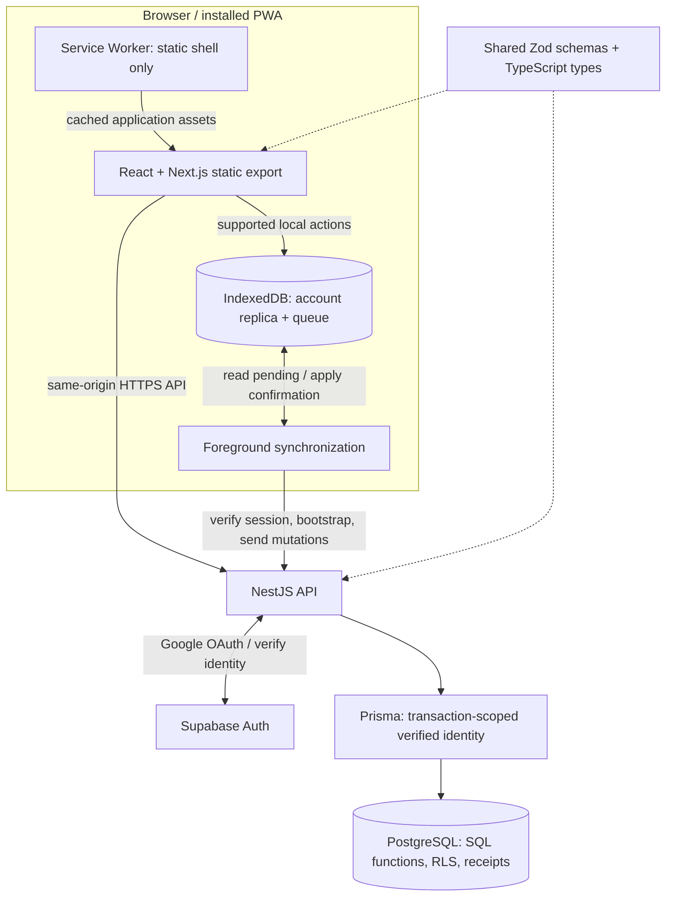

# Architecture

[Back to the showcase](../README.en.md) · [Português](architecture.md)

The application separates the static interface, local replica, authenticated API, and database. Offline persistence is explicit application logic; it does not rely on caching authenticated API responses.

## Responsibilities

**Frontend.** Next.js exports static files rather than running server-side session handlers. The browser uses the same-origin NestJS API for authenticated operations. The interface distinguishes local persistence from remote confirmation.

**Local replica.** IndexedDB holds confirmed state, the authorized food catalog, and pending operations in account-specific partitions. The displayed state projects pending actions over confirmed data. The multi-food selection draft is separate: it can be recovered locally but is not itself a queued consumption or a cross-device draft.

**Service Worker.** The worker caches application assets. Authenticated API responses and OAuth traffic are excluded from its cache; account data is managed by the replica instead.

**Backend.** NestJS handles Google OAuth through Supabase Auth and verifies identity before accessing account data. Authentication tokens remain in HTTP-only cookies; browser JavaScript receives a minimal account profile. Shared Zod contracts validate exchanged data.

**Database.** Prisma opens transactions with identity claims derived from the verified session. SQL functions enforce domain rules and perform transactional mutations, with row-level security protecting account-owned data. The browser does not connect directly to PostgreSQL.

## A supported offline action

1. After online account preparation, the user records an individual diary action without a connection.
2. An IndexedDB transaction persists the operation under that account. The local projection makes it visible; a failed write does not report a successful save.
3. On reconnection, focus, application opening, or a manual request, the sender acquires the account's synchronization lock and revalidates the session.
4. Pending operations are sent in order with their original identifiers and payloads.
5. PostgreSQL applies an operation and writes its receipt in one transaction, or returns a recoverable conflict.
6. On acknowledgment, the client removes only the acknowledged operation, updates confirmed state, and projects the remaining queue, including actions created while the request was in flight.

The server checks the expected account as well as the session. An expired session preserves pending work for reauthentication; switching accounts does not move that work to the new account.

## Concurrency and recovery

Web Locks coordinate synchronization across tabs. Where unavailable, an IndexedDB lease provides a fallback. BroadcastChannel tells peer tabs to reread state. These client mechanisms reduce concurrent sends; database receipts enforce replay safety even when the client retries.

Bootstrap responses are validated and checked against the captured confirmed-state version before being stored. A stale response arriving after a newer acknowledgment cannot overwrite that newer confirmed snapshot.

Conflicts in goal history or nutritional references pause the queue for explicit resolution. They are not resolved by silently replacing one version with another.

## Catalog and reference identity

v0.7.0 preserves all 597 TACO foods and IDs and adds 19 curated USDA SR Legacy references, totaling 616. Additive migrations retain each food’s global ID, while the `source_key` and textual `source_id` pair distinguishes codes across sources. Food details display attribution, and provenance metadata allows the batches to be checked against the official USDA archive. TBCA remained research, with no data incorporated.

Search and recording do not call an external nutrition API. The API delivers the complete authorized catalog through bootstrap; new foods change `catalogRevision` and enter the replica after synchronization. The synchronized catalog is searchable offline, without expanding the supported offline write actions.

## Reuse and authorship without changing the past

“Copy yesterday’s meal” starts from the destination card and uses the day before the selected date. It reuses the existing meal review with explicit source and destination and historical snapshots; opening or canceling the review creates no consumption. Confirmation remains part of the online reuse flow, and canceling restores focus to the trigger.

“My foods” lists active private and public foods created by the account. Backend and database authorization restrict editing to the author while preserving ID and visibility. Public edits update the reference for new consumption without recalculating previous entries or nutritional calculation bases; public foods cannot be deleted. This flow requires a connection and prior synchronization of pending work. References changed before a consumption sync still use explicit `food_changed` recovery.

## Hosting boundary

The private project has deployment configuration for serving the exported frontend and NestJS API on Vercel, with Supabase providing Auth and PostgreSQL. This diagram describes the application design. It does not certify the state of a hosted deployment, OAuth configuration, or production cache headers.
