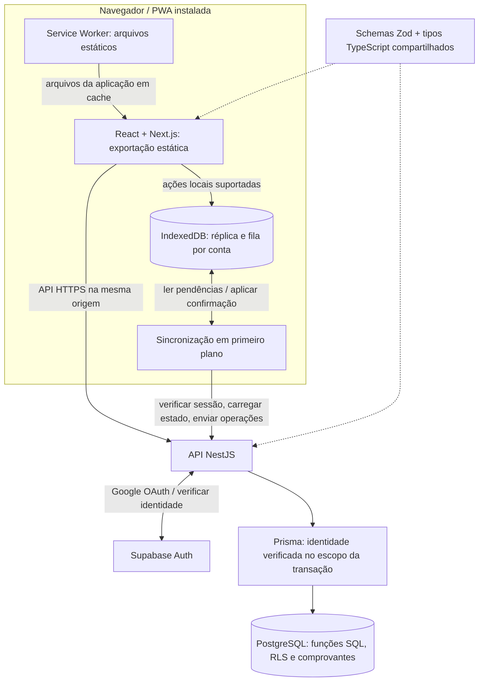

# Arquitetura

[Voltar ao showcase](../README.md) · [English](architecture.en.md)

A aplicação separa interface estática, réplica local, API autenticada e banco de dados. A persistência offline é uma responsabilidade explícita da aplicação e não depende de cache de respostas autenticadas da API.

## Responsabilidades

**Frontend.** O Next.js exporta arquivos estáticos, sem executar handlers de sessão no servidor. O navegador usa a API NestJS na mesma origem para operações autenticadas. A interface distingue persistência local de confirmação remota.

**Réplica local.** O IndexedDB mantém estado confirmado, catálogo autorizado e operações pendentes em partições por conta. O estado exibido é uma projeção das pendências sobre os dados confirmados. O rascunho da seleção de vários alimentos é separado: pode ser recuperado localmente, mas não representa consumo enfileirado nem é sincronizado entre dispositivos.

**Service Worker.** Mantém o cache dos arquivos da aplicação. Respostas autenticadas da API e tráfego OAuth ficam fora desse cache; os dados da conta são gerenciados pela réplica.

**Backend.** O NestJS conduz o Google OAuth por meio do Supabase Auth e verifica a identidade antes de acessar dados da conta. Tokens de autenticação ficam em cookies HttpOnly; o JavaScript recebe um perfil mínimo da conta. Contratos Zod compartilhados validam os dados trocados.

**Banco de dados.** O Prisma abre transações com claims derivados da sessão verificada. Funções SQL aplicam regras de domínio e mutações transacionais, com segurança por linha (RLS) protegendo os dados de cada conta. O navegador não se conecta diretamente ao PostgreSQL.

## Fluxo de uma ação offline suportada

1. Após a preparação online da conta, a pessoa registra uma ação individual do diário sem conexão.
2. Uma transação IndexedDB persiste a operação na partição da conta. A projeção local a torna visível; falhas de gravação não informam que o salvamento foi concluído.
3. Ao reconectar, voltar ao aplicativo, abri-lo ou solicitar sincronização manual, o remetente adquire o lock da conta e revalida a sessão.
4. As operações pendentes são enviadas em ordem, com identificadores e payloads originais.
5. O PostgreSQL aplica a operação e grava seu comprovante na mesma transação, ou devolve um conflito recuperável.
6. Na confirmação, o cliente remove apenas a operação reconhecida, atualiza o estado confirmado e projeta a fila restante, incluindo ações criadas durante a requisição.

O servidor verifica a conta esperada além da sessão. Uma sessão expirada preserva as pendências para reautenticação; trocar de conta não transfere esse trabalho para a nova conta.

## Concorrência e recuperação

Web Locks coordenam a sincronização entre abas. Quando indisponíveis, um lease no IndexedDB funciona como alternativa. O BroadcastChannel avisa as outras abas para reler o estado. Esses mecanismos reduzem envios simultâneos; os comprovantes no banco garantem repetição segura mesmo quando o cliente reenvia uma operação.

Respostas de bootstrap são validadas e comparadas à versão do estado confirmado capturada antes da requisição. Uma resposta antiga que chega depois de uma confirmação mais nova não pode sobrescrever esse estado atualizado.

Conflitos no histórico de metas ou nas referências nutricionais pausam a fila para resolução explícita. Uma versão não substitui silenciosamente a outra.

## Catálogo e identidade das referências

A v0.7.0 preserva os 597 alimentos e IDs TACO e acrescenta 19 referências curadas USDA SR Legacy, totalizando 616. As migrations são aditivas: o ID global do alimento permanece estável, enquanto o par `source_key` e `source_id` textual distingue códigos de fontes diferentes. A atribuição aparece no detalhe, e os metadados de origem permitem conferir os lotes com o arquivo oficial USDA. TBCA permaneceu pesquisa, sem dados incorporados.

Busca e registro não consultam uma API nutricional externa. A API entrega o catálogo autorizado completo no bootstrap; novos alimentos alteram `catalogRevision` e passam a integrar a réplica após sincronização. O catálogo já sincronizado pode ser pesquisado offline, sem ampliar as ações de escrita suportadas offline.

## Reutilização e autoria sem alterar o passado

O atalho “Copiar refeição de ontem” parte do card de destino e considera a véspera da data selecionada. Reutiliza a revisão de refeições existente, com origem e destino explícitos e snapshots históricos; abrir ou cancelar a revisão não cria consumo. A confirmação continua no fluxo online de reutilização, e o cancelamento devolve o foco ao acionador.

“Meus alimentos” lista os alimentos ativos privados e públicos criados pela conta. A autorização no backend e no banco restringe a edição ao autor, preservando ID e visibilidade. A edição pública atualiza a referência para novos consumos, sem recalcular registros e bases nutricionais anteriores; alimentos públicos não podem ser excluídos. O fluxo exige conexão e sincronização prévia das pendências. Referências alteradas antes de sincronizar um consumo continuam passando pela recuperação explícita de `food_changed`.

## Hospedagem

O projeto privado possui configuração para servir o frontend exportado e a API NestJS na Vercel, com Supabase fornecendo Auth e PostgreSQL. O diagrama descreve o projeto da aplicação. Não certifica o estado de um deploy hospedado, a configuração OAuth ou os headers de cache em produção.
